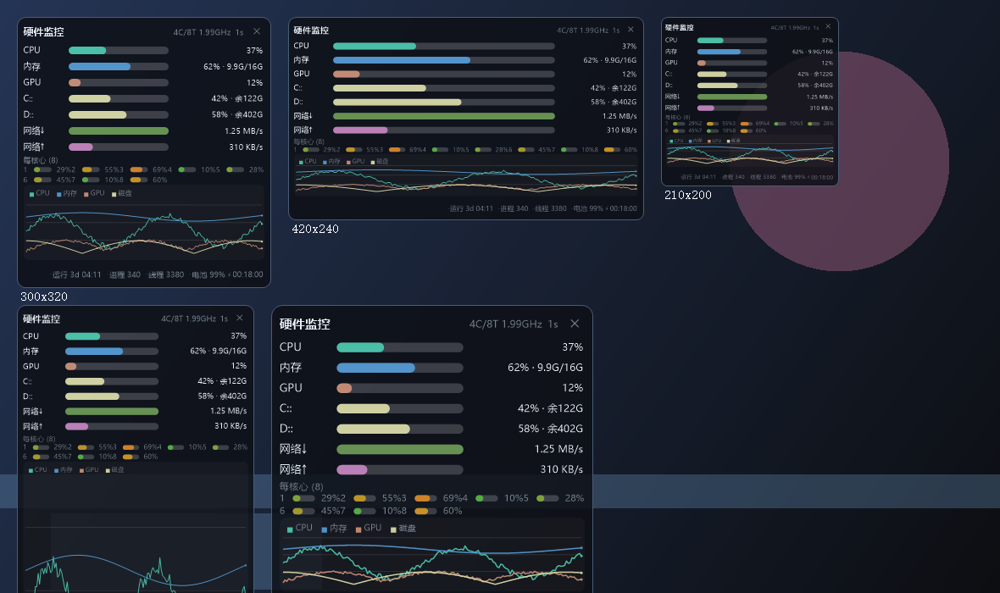

# 硬件监控浮窗 · HardwareMonitor

轻量、透明、可拖动、可缩放的 Windows 硬件利用率检测器 —— **单文件 exe，约 99 KB，零第三方依赖**。

> 仅使用 Windows 自带的 .NET Framework（Win8/10/11 默认内置）与 Win32/NT 原生接口，
> 不打包运行时、不安装驱动、不写系统目录、不需要管理员权限。



---

## 1. 功能

| 显示项 | 数据来源 | 说明 |
| --- | --- | --- |
| **CPU 总利用率** | `NtQuerySystemInformation(SystemProcessorPerformanceInformation)` | 内核级每核时间差，1 次调用拿到全部核心 |
| **每核心占用** | 同上 | 每个逻辑核一条迷你进度条，按负载红黄绿渐变 |
| **内存占用** | `GlobalMemoryStatusEx` | 百分比 + 已用/总量 |
| **GPU 利用率** | PDH `\GPU Engine(*)\Utilization Percentage` | 3D / Compute / Copy / Video 引擎实例求和；不可用时自动隐藏该行 |
| **磁盘容量** | `GetDiskFreeSpaceEx` | 每个固定盘一行：已用百分比 + 剩余空间 |
| **磁盘活动** | PDH `\PhysicalDisk(_Total)\% Disk Time` | 绘制在历史曲线中 |
| **网络速率** | `NetworkInterface.GetIPv4Statistics` | 上下行实时速率，动态量程 |
| **进程 / 线程数** | PDH `\System\Processes`、`\System\Threads` | 底部信息栏 |
| **电池 / 电源** | `GetSystemPowerStatus` | 有电池时才显示 |
| **运行时间 / 时钟** | `GetTickCount64`、本地时间 | 底部信息栏 |
| **历史曲线** | 内部环形缓冲 | CPU / 内存 / GPU / 磁盘最近 240 个采样点 |

界面元素可逐项开关（右键菜单 → 显示项目），布局随窗口尺寸整体等比缩放，
**任何尺寸下都不会出现文字截断或元素越界**（见第 6 节自动化验证）。

---

## 2. 交互方式

| 操作 | 效果 |
| --- | --- |
| 按住窗口任意空白处拖动 | 移动浮窗（靠近屏幕边缘自动吸附） |
| 拖动窗口边缘 / 四角 | 缩放窗口，全部内容跟随等比缩放 |
| **双击** | 切换迷你模式（只保留 CPU / 内存 / 网络 / 底部信息） |
| **右键** | 打开菜单 |
| 点击右上角 ✕ | 退出程序 |
| 托盘图标双击 | 显示 / 隐藏浮窗 |
| 托盘图标右键 | 与浮窗右键同一套菜单 |

右键菜单包含：窗口置顶、显示项目（8 项）、背景不透明度（7 档）、刷新间隔（0.5/1/2/3/5 秒）、
迷你模式、重置位置与大小、开机自动启动、隐藏到托盘、退出。

---

## 3. 安装

### 方式 A：便携运行（推荐）
直接双击 `HardwareMonitor.exe`，无需安装。

### 方式 B：安装程序
双击 `setup.exe`：

* 安装到 `%LOCALAPPDATA%\Programs\HardwareMonitor`（当前用户，**不需要管理员权限**）
* 可选创建桌面快捷方式、可选开机自动启动
* 注册标准卸载项（设置 → 应用 → 硬件监控浮窗 → 卸载）
* 卸载器为安装目录下的 `uninstall.exe`，会一并清理快捷方式与注册表项

命令行（静默安装，可用于脚本分发）：

```bat
setup.exe --silent --dir "D:\Tools\HardwareMonitor" --no-shortcuts
setup.exe --uninstall --silent
```

---

## 4. 配置文件

优先写入 `%APPDATA%\HwMon\config.ini`；若该位置不可写（绿色版 / 受限环境），
自动回退到 exe 同目录的 `HwMon.ini`。保存内容：窗口位置尺寸、不透明度、置顶状态、
显示项目开关、刷新间隔、迷你模式。

---

## 5. 资源占用（实测）

测试机：Intel i7-8550U / Windows 11 (10.0.28000) / 125% 缩放 / 刷新间隔 1 秒。

| 项目 | 实测值 |
| --- | --- |
| 主程序体积 | **101 KB**（单文件，含图标与 DPI 清单） |
| 安装包体积 | 148 KB |
| 内存工作集 | ≈ 51 MB（其中私有 ≈ 37 MB） |
| CPU 占用 | 8 秒内累计 250 ms ≈ **单核 3.1%**（8 线程机器上约 0.4% 总 CPU） |
| GDI 句柄 | 441 个句柄 / 12 个线程 |
| 磁盘写入 | 仅配置变更时写一次 ini |

> 采样全部在独立后台线程完成，界面线程每秒只做一次绘制，因此不会卡顿。
> 关闭「GPU 使用率」显示项后，程序会完全停止查询性能计数器，占用进一步下降。

---

## 6. 自动化验证

程序内置三个自检模式，便于在无人值守/CI 环境下验证：

```bat
HardwareMonitor.exe --selftest out.txt     :: 真实采集一遍全部指标并写出报告
HardwareMonitor.exe --render preview.png   :: 用合成数据渲染 5 种尺寸对照图（含透明背景）
HardwareMonitor.exe --verify  verify       :: 真机显示浮窗 → 截图 → 隐藏 → 再截图，做逐像素比对
```

**布局自检**（`docs/verification-layout.txt`）：2 种模式 × 10 种尺寸 = 20 组，
全部 `clip = 0`、`minShrink = 1.00`、`usedBottom ≤ 窗口高度`，
即不存在文字截断、元素越界或溢出，满足「元素显示全面」。

**端到端透明验证**（`docs/verification-transparency.txt`）：

```
窗口矩形(物理): 60,60 340x420   客户区: 340x420   DPI: system=120 window=120
渲染自检: scale=1.133 usedBottom=410.9 clip=0 minShrink=1.00
面板平均改变 : 93.3 / 255
四角平均色差 : 6.89  阈值 < 23.3  (圆角外完全透明)
背景相关性   : 0.238  (>0 表示背景透过半透明面板可见)
覆盖像素比例 : 99.1%
结论: 通过 —— 逐像素透明生效，半透明背景可见，内容未溢出窗口
```

---

## 7. 编译（无需 Visual Studio / .NET SDK）

只用 Windows 自带的 C# 编译器 `%WINDIR%\Microsoft.NET\Framework64\v4.0.30319\csc.exe`
（.NET Framework 4.x，语言版本 C# 5）。

```bat
build.cmd        :: 编译主程序 HardwareMonitor.exe
build-all.cmd    :: 编译主程序 + setup.exe + 便携 zip + SHA256 校验文件
```

> **代码签名（彻底消除 SmartScreen「无法识别的应用」）**：`build.cmd` / `build-all.cmd`
> 编译完成后会自动调用 `sign.ps1` 进行 Authenticode 签名。未提供证书时自动跳过，
> 行为与改动前一致。要让最终用户机器不再弹窗，需在构建机上准备一个**受公众信任 CA 颁发的
> 代码签名证书**（**EV 证书**即时生效，**OV/IV 证书**在积累下载量后生效），并通过
> `CODESIGN_PFX` / `CODESIGN_PASSWORD` 环境变量（或 `-Thumbprint`）提供给 `sign.ps1`。
> 详见 `sign.ps1` 文件头注释。
```

手动编译等价命令：

```bat
cd src
csc -target:winexe -optimize+ -out:..\HardwareMonitor.exe ^
    -win32manifest:..\app.manifest -win32icon:..\icon.ico ^
    -r:System.dll -r:System.Drawing.dll -r:System.Windows.Forms.dll ^
    Native.cs Util.cs Settings.cs Sampler.cs Renderer.cs OverlayForm.cs Program.cs

cd ..\installer
csc -target:winexe -optimize+ -out:..\setup.exe ^
    -win32manifest:..\app.manifest -win32icon:..\icon.ico ^
    -resource:..\HardwareMonitor.exe,HwMonPayload.exe ^
    -r:System.dll -r:System.Drawing.dll -r:System.Windows.Forms.dll Setup.cs
```

---

## 8. 目录结构

```
HardwareMonitor/
├── src/                    主程序源码（C# 5 / WinForms + Win32 互操作）
│   ├── Native.cs           Win32 / NT / PDH 原生调用封装
│   ├── Sampler.cs          后台采样线程、环形历史缓冲、机器信息探测
│   ├── Renderer.cs         纯绘制层：自适应布局、进度条、曲线、文字缩放
│   ├── OverlayForm.cs      分层透明窗口：拖动、缩放、托盘、右键菜单
│   ├── Settings.cs         ini 配置读写（含便携回退）与开机自启
│   ├── Util.cs             日志、单位格式化、字体缓存
│   └── Program.cs          入口 + selftest / render / verify / shot 自检模式
├── installer/Setup.cs      安装 / 卸载程序（自包含，内嵌主程序）
├── tools/
│   ├── MkIcon.cs           生成多尺寸 icon.ico（编译期工具）
│   └── Publish.cs          无 gh 依赖的发布器（建仓库 / 推送 / 建 Release / 传附件）
├── app.manifest            PerMonitorV2 DPI 感知 + asInvoker
├── icon.ico                程序图标
├── build.cmd               编译主程序
├── build-all.cmd           全量构建（主程序 + 安装包 + 发布包 + 校验）
├── publish.ps1             一键发布到 GitHub（建仓库 + 推送 + 建 Release + 传附件）
├── docs/                   预览图与验证报告
├── release/                发布产物（便携 zip + SHA256SUMS.txt）
├── HardwareMonitor.exe     主程序
└── setup.exe               安装程序
```

---

## 9. 已知限制

* **CPU 温度未提供**：Windows 上获取温度需要管理员权限且 WMI 支持在不同主板上不一致，为保证「小占用 + 免管理员」刻意不做。
* **GPU 利用率**依赖 Windows 性能计数器对象 `GPU Engine`；极少数旧驱动或纯虚拟机环境下不存在，此时该行自动隐藏，其余功能不受影响。
* 需要 .NET Framework 4.5 及以上（Windows 8/10/11 默认内置，无需额外安装）。
* 逐像素透明窗口在极少数“强制禁用桌面合成”的旧系统上会退化为普通窗口。

---

## 10. 发布到 GitHub

本仓库已发布：<https://github.com/ml-308/hardware-monitor-overlay> ，
Release：<https://github.com/ml-308/hardware-monitor-overlay/releases/tag/v1.0.0>

方式一（PowerShell，无需 gh）：

```powershell
$env:GITHUB_TOKEN = "ghp_xxxxxxxx"        # 生成 Token 时勾选 repo 权限
powershell -ExecutionPolicy Bypass -File publish.ps1 -Owner 你的用户名
```

方式二（自包含发布器 `tools/Publish.cs`，可复用本机已保存的 git 凭据）：

```bat
csc -nologo -target:exe -out:Publish.exe tools\Publish.cs
Publish.exe --owner 你的用户名          :: 建仓库 + 推送 + Release + 上传附件
Publish.exe --code-only                 :: 只推送代码更新
```

两种方式都会上传以下发布产物：`HardwareMonitor.exe`、`setup.exe`、
`release/HardwareMonitor-1.0.0-portable.zip`、`release/SHA256SUMS.txt`。

---

## 11. 许可

[MIT](LICENSE)
